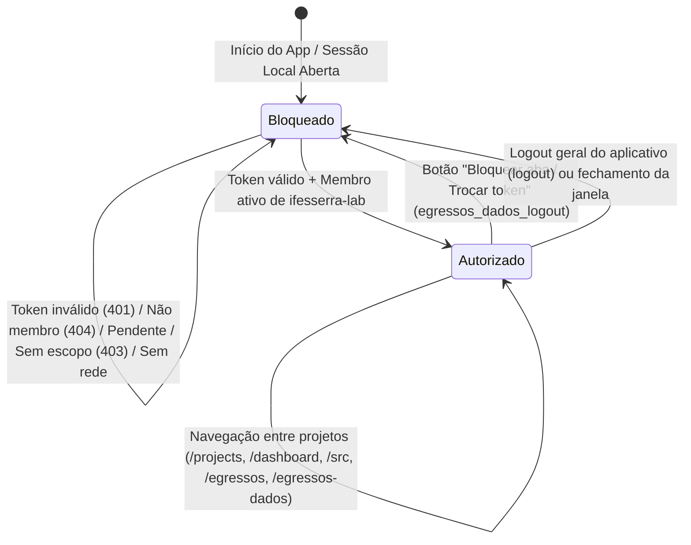

# Data Model: Controle de Acesso Exclusivo à Aba `egressos-dados` (`036-egressos-github-org-auth`)

**Date**: 2026-11-05 | **Feature**: [spec.md](./spec.md) | **Research**: [research.md](./research.md)

## 1. Modelo de Estado em Memória (`src-tauri/src/state.rs`)

Por decisão explícita de segurança (`FR-008`, `FR-009`, Clarificação Q2), esta feature **não persiste o token nem o estado do login especial em disco** (nenhuma tabela nova no SQLite e nenhuma gravação em `sync_config.json`). Todo o estado reside exclusivamente em memória dentro de `AppState`.

### 1.1. Entidade `EgressosDadosAuth` (Interna ao Processo Rust)

Representa a sessão de autorização especial ativa para a aba `egressos-dados`.

| Campo | Tipo Rust | Visibilidade IPC | Descrição |
|-------|-----------|------------------|-----------|
| `login` | `String` | Pública (via `EgressosDadosAuthStatus`) | Nome de usuário (`login`) autenticado no GitHub (ex.: `"thiagodeps"`). |
| `organization` | `String` | Pública (via `EgressosDadosAuthStatus`) | Nome canônico da organização validada — sempre `"ifesserra-lab"`. |
| `token` | `String` | **Privada (NUNCA serializada no IPC)** | Token de acesso pessoal do GitHub mantido apenas em memória para uso pelos futuros comandos de sincronização/leitura de JSONs da aba `egressos-dados`. |
| `token_hint` | `String` | Pública (via `EgressosDadosAuthStatus`) | Últimos 4 caracteres do token (ex.: `"9f2a"`) para identificação visual sem expor o segredo. |

### 1.2. Visão Pública `EgressosDadosAuthStatus` (Serializada via IPC)

Estrutura retornada pelos comandos `egressos_dados_login` e `egressos_dados_status` para o front-end:

```json
{
  "authorized": true,
  "login": "thiagodeps",
  "organization": "ifesserra-lab",
  "token_hint": "9f2a"
}
```

Quando bloqueada (`authorized == false`):

```json
{
  "authorized": false,
  "login": null,
  "organization": "ifesserra-lab",
  "token_hint": null
}
```

---

## 2. Resultado da Verificação no Cliente GitHub (`src-tauri/src/sync_github.rs`)

### 2.1. Constante Canônica
- `pub const REQUIRED_EGRESSOS_DADOS_ORG: &str = "ifesserra-lab";`

### 2.2. Estrutura `OrgMembershipInfo`

Retornada por `GitHubClient::verify_org_membership(org: &str)`:

| Campo | Tipo | Descrição |
|-------|------|-----------|
| `login` | `String` | Login do usuário no GitHub obtido de `GET /user`. |
| `organization` | `String` | Organização verificada (`"ifesserra-lab"`). |
| `state` | `String` | Estado confirmado da filiação (`"active"`). |

---

## 3. Transições de Estado e Regras de Validação



### Regras Invariantes (`FR-003`..`FR-009`):
1. **Pré-condição de sessão local**: Nenhuma operação de `egressos-dados` pode ser executada se a sessão local do Research Hub (`state.require_session()`) não estiver aberta.
2. **Validação de entrada**: O token informado passa por `.trim()`; se vazio, falha imediatamente com `AppError::Validation("Informe um Token de Acesso Pessoal do GitHub.")` antes de qualquer chamada de rede.
3. **Critério único de aprovação**: `EgressosDadosAuth` só é gravado em `AppState` se o GitHub confirmar que o token pertence a um usuário válido **e** que sua filiação à organização `ifesserra-lab` está ativa (`state == "active"` em `/user/memberships/orgs/ifesserra-lab` ou `204 No Content` em `/orgs/ifesserra-lab/members/{login}`).
4. **Atomicidade em caso de falha**: Se uma tentativa de login especial falhar (mesmo quando havia uma autorização anterior), o slot `egressos_dados_auth` permanece/torna-se `None` (`Bloqueado`).
5. **Limpeza em cascata no Logout Geral**: `AppState::close_session()` limpa tanto `session` quanto `egressos_dados_auth`.
6. **Sigilo do Token (`SC-003`)**: O valor completo do `token` nunca é incluído em `AppError`, `EgressosDadosAuthStatus`, logs ou eventos.
